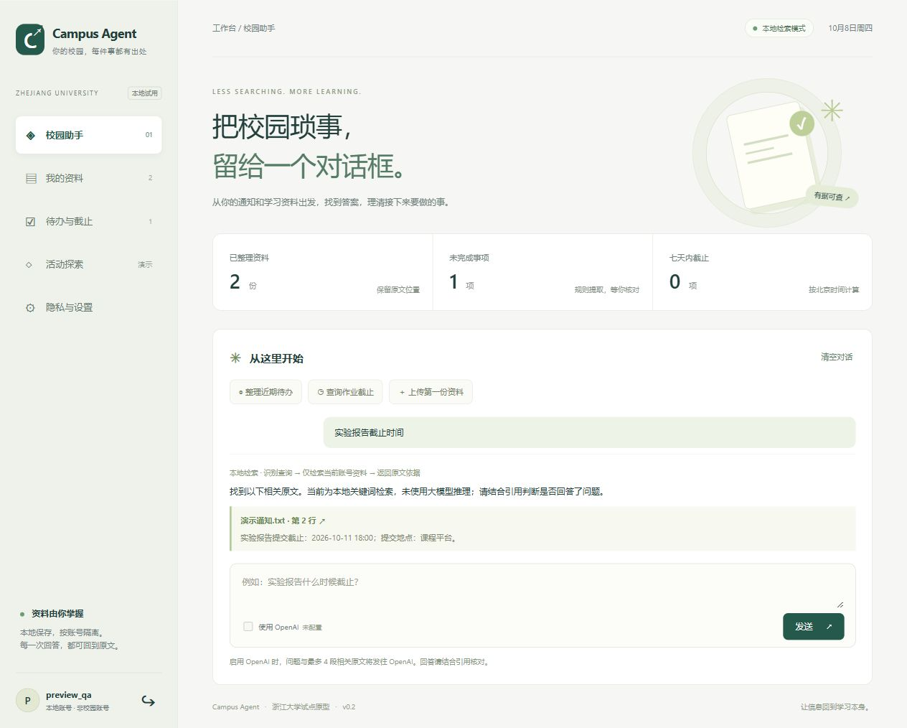

# Campus Agent

面向浙江大学学生的校园资料工作台。**v0.2 已实现可运行的本地 Web 闭环**：上传资料、提取待办、检索原文、核对时间及删除资料。支持由用户在本机配置的 OpenAI 接口，默认关闭。

这不是学校官方服务。新增可选的本机浙大通行证登录和本科教务信息同步，已完成一次本人测试账号联调；学校接口仍可能超时或限制访问。实时通知、自动报名和真实学分认定仍未接入。



交付范围、验证结果和后续事项见 [成果清单](docs/delivery.md)。

## 已实现

- Web 对话、资料库、待办、活动演示和设置，含窄屏布局。
- 通行证登录作为主入口、登录后自动获取信息、默认恢复本浏览器已验证账号的离线缓存；会话/CSRF 校验及按账号隔离的 SQLite 数据，旧版资料可显式绑定迁移。
- TXT、PDF、DOCX、PPTX 上传、异步解析、去重、状态与错误提示。
- 按行、PDF 页、DOCX 段落/表格、PPTX 页定位，引用可回到原文。
- 通知候选待办、明确截止时间提取、人工修正与完成状态。
- 本地中文关键词检索，以及可选 OpenAI Responses 问答、引用校验和失败回退。
- 单份/全部资料删除，级联清理片段与待办；脱敏操作日志。
- 保留阶段 0 的 CLI、Mock Connector 和活动冲突规则。
- “我的学业”页：通行证登录时自动获取课表、基本信息及全部可见成绩；ETA 个人基本信息和教务个人页补充学院、专业、班级及年级，逐字段记录来源与时间，失败保留缓存。支持续传、学期筛选、按账号保存和断开清除，校园密码与 cookie 不落盘。主会话在进程内为本科教务与 ETA 即时换票。见 [通行证与离线缓存](docs/passport-login.md)。
- 学业可视化：今日课程与通知待办、周课表、按学期均绩和分页成绩详情。日期按学校校历、同学期缓存、默认推算逐级降级，校历不可用也可显示今日课程和日期日历；推算会标注来源，当前官方自动校历适配主校区本科秋冬学期，见 [学业界面说明](docs/academic-ui.md)。

## 下载后使用（v0.2.1）

每位同学都可以在自己的电脑运行，不需要开发者电脑在线。当前是本地应用，不是共享的在线网站；账号、资料和模型配置各自独立。

1. 安装 **Python 3.10+，推荐 3.12**（Windows 安装时勾选 Add Python to PATH）。
2. 在 GitHub 点击 **Code → Download ZIP** 并完整解压；开发者也可 `git clone https://github.com/cmy173/campus-agent.git`。
3. **Windows：双击 `start.cmd`。macOS/Linux：在项目目录执行 `sh start.sh`。**
4. 首次启动自动创建 `.venv` 并联网安装依赖，随后自动打开网页。保留启动窗口，Ctrl+C 停止。
5. 可选择“本地试用 / 注册”体验资料检索，或使用通行证登录并同步本人教务信息。真实账号适配仍需本人验证，不需要 API Key 即可试用。

打开 **http://127.0.0.1:8765**，使用浙大通行证登录，程序自动获取教务信息；已有浏览器会话默认显示离线缓存。旧版本地账号从“旧版本地资料登录”进入，可在设置中绑定通行证。后续可运行 `./start.ps1`，Ctrl+C 停止。详细的模型配置、备份和常见限制见 [本地运行说明](docs/local-setup.md)。
之后仍使用同一启动入口。通用命令为 `python launch.py`（macOS/Linux 使用 `python3`）。端口占用时使用 `python launch.py --port 8766`；无需自动打开浏览器时添加 `--no-browser`。

首次需要联网下载依赖；安装成功后，本地检索无需模型服务。OpenAI 问答需自行配置，说明见 [本地运行说明](docs/local-setup.md)。此版本在 Windows 做全新安装验证，macOS/Linux 提供启动入口但尚未实机验证。

## 当前状态

| 能力 | 状态 |
|---|---|
| 上传、检索、原文引用、待办核对 | 已实现并以合成资料验证 |
| OpenAI 问答 | 接口和模拟响应测试完成，真实密钥/模型尚未联调 |
| 活动推荐 | 仅虚构数据，不代表浙大学分规则 |
| 浙大通行证、本科教务与 ETA 基本信息同步 | 已通过合成验证及一次本人测试账号联调；接口失败保留缓存，仅本机使用 |
| 实时通知、其他平台、自动报名 | 未接入，需要对应接口与授权 |
| OCR、音视频、完整课程规划 | 未实现 |
| 公网多人服务 | 未完成，当前限定本机试用 |

本地检索使用中文双字片段及英文词匹配，不等同于语义检索。日期不明确时保留待核对。来源存在性校验不等于模型事实正确性保证。

## 测试

```powershell
.\.venv\Scripts\python.exe -m pip install -r requirements-dev.txt
.\.venv\Scripts\python.exe -m unittest discover -s tests -v
```

测试使用合成资料与模拟模型，不消耗 API 额度。实际验证结果见 [验证记录](docs/validation.md)。

## 文档与代码

[愿景](docs/vision.md) · [需求](docs/requirements.md) · [架构](docs/architecture.md) · [平台调研](docs/integrations.md) · [安全](docs/security.md) · [技术选型](docs/tech-stack.md) · [MVP](docs/mvp.md) · [路线图](docs/roadmap.md) · [待决策事项](docs/open-questions.md) · [API](docs/api.md)

`core.py` 为阶段 0 原型；`web.py` 为 REST、身份与编排；`storage.py` 管理 SQLite；`parser_worker.py` 解析文件；`services.py` 提取与检索；`llm.py` 适配 OpenAI；`static/` 为无需构建的原生 HTML/CSS/JS 前端；`server.py` 为启动入口。

数据默认保存在 `data/`，不要提交或分享。许可证仍待团队决定。
