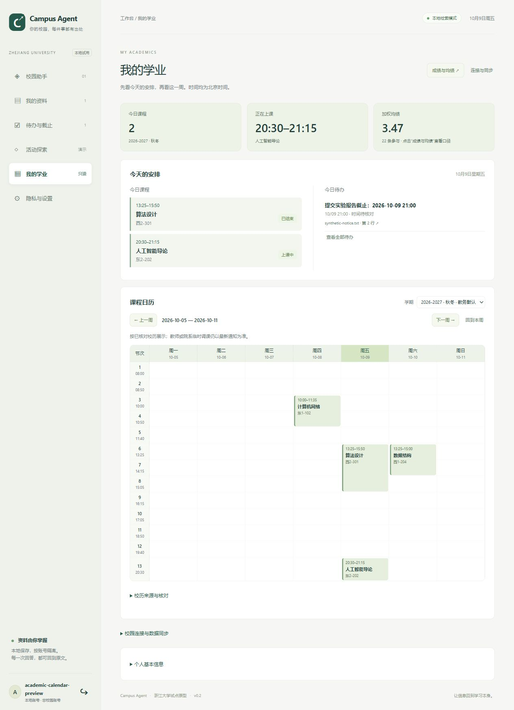
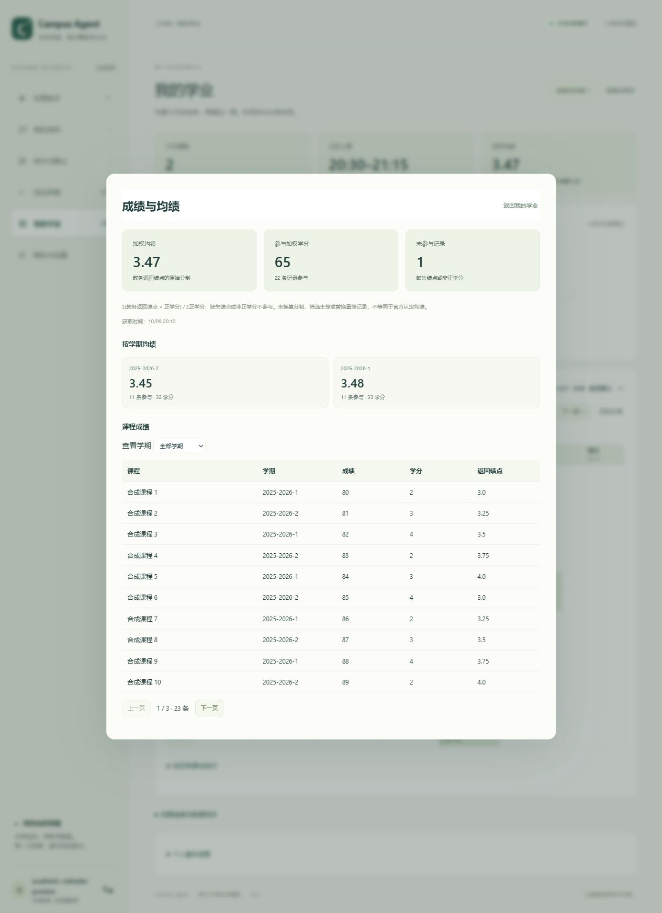
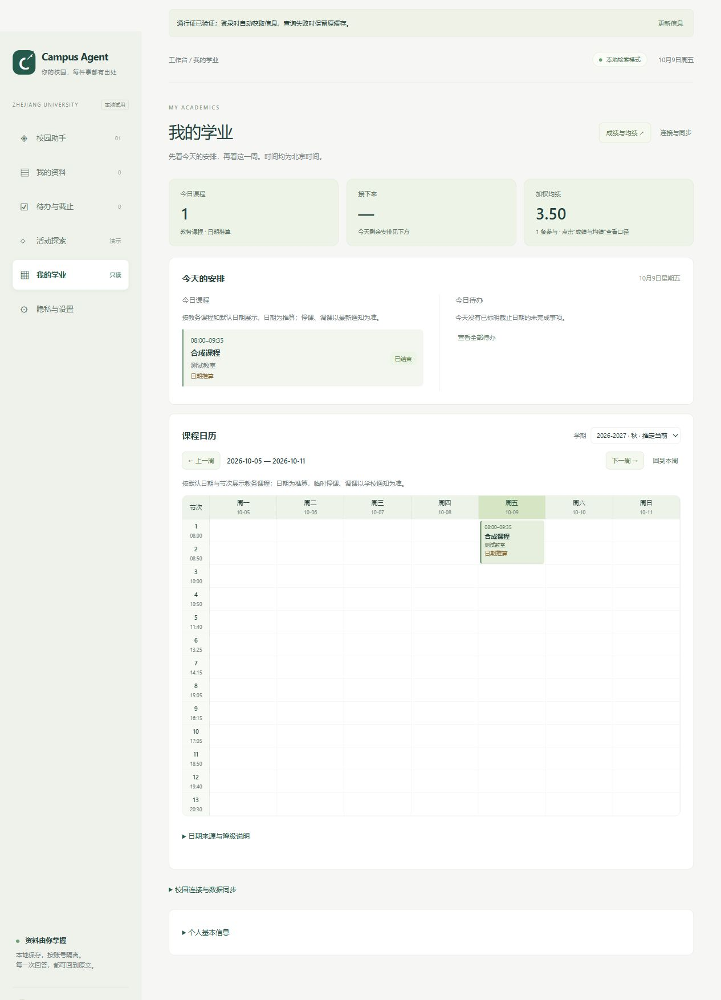
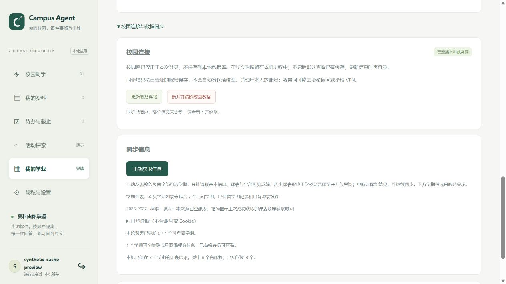

# 我的学业：日历、今日安排与成绩概览

更新：2026-10-09。展示层复用按账号保存的教务快照和通知待办，保留来源、获取时间、失败及不完整状态。课程不写成可勾选的待办，不向校园平台提交操作，也不进入模型输入。

## 日常入口

首页优先展示今日课程、接下来的课程、今日截止的未完成通知待办及周课表。逾期、无截止日期的候选待办有单独计数和“查看全部待办”入口；通知时间待核对时保持标签，可回到原文。连接/同步与个人信息折叠，不占日常查看的主位置。

课表直接使用教务接口的星期、节次、季学期与单双周，不再以校历严格核对作为展示前提。明确给出周次时按季学期计算；周次未提供时按季学期和单双周展示，季学期未提供时使用所查询学期，并在课程详情列出补齐规则。无法解析的星期、节次或显式异常周次仍保留来源字段。冲突课程同时显示，历史周切换不改变今日安排。

## 日期来源与自动降级

默认直接展示日期日历和今日课程，按以下顺序补充日期：

1. 已成功读取的学校校历。
2. 对应学期的校历缓存；更新失败或超过六小时仍可用于展示，保留原获取时间和“校历缓存”标记。
3. 参照 Celechron 的默认配置：秋季从 9 月 14 日及其后的首个周一开始，春季从次年 2 月 20 日及其后的首个周一开始；每季八周，后半季紧接前半季。节次使用已核对模板或内置主校区本科时间（08:00 起，共 15 节）。日期标注“推算”，节假日、调课列表留空。

默认规则只补齐课程的日期与时钟，不生成课程、成绩、身份资料。跨学年缓存只提供节次时间模板，不挪用开学日期、节假日或调课。无法识别所属长学期的短学期或未知编码仍显示星期课表。

学校已发布的停课、调课照常应用；尚未覆盖的活动/调课日期按常规课表展示并标注，而非留空。默认主校区时间不声称适用于海宁等独立院历。默认日期可能偏离实际校历，教师临时安排以最新教务和课程通知为准。

打开在线会话下的当前学期时，会尝试一次学校来源更新，更新期间已有课表可继续查看；失败不自动循环请求。离线查看不主动访问校园来源。也可在“日期来源与降级说明”手动点击“更新学校校历”。官方获取流程仍从本科生院固定目录发现 PDF、本机识别，与官网日期及教务通知交叉检查，保存 URL、SHA-256、获取时间和范围；只有这条路径成功才标为官方核对通过。官方读取失败会调用上述降级，不再阻断日期事件。

官方校历读取限 HTTPS 固定学校域名，不持有 CAS cookie；最多 60 秒、PDF 10 MB / 4 页、识别子进程 25 秒。当前自动读取适配主校区本科秋冬学期，春夏可直接使用默认日期。学校目录、版式、语言包或通知变化不会清空已获取课程。

## 成绩二级界面

“成绩与均绩”打开单独的详情界面：累计加权均绩、参与加权的学分和排除记录数；学期卡片展示各学期均绩，点击筛选该学期；逐课成绩每页十条，不在首页展开长表。

公式为 `Σ(教务返回的有效数值绩点 × 正学分) / Σ正学分`。返回绩点 `0` 保留参与，缺失绩点、无效学分、零或负学分不参与；没有可计算记录显示“—”，不显示误导性的 0 均绩。仅使用返回的原始分制，不从“优秀/合格”等文字推断绩点，不转换四分制、不猜主修范围、不替换重修记录。各学期按成绩来源的学期字段分组，未知学期保留独立分组。结果是已有记录的汇总，不等同于官方认定均绩或毕业学分；缓存、缺页和排除范围会显示。

## 结构与依据

- `academic_defaults.py`：原始参数兼容、有限学期探测、同学期缓存与默认日期。
- `academics.py`：均绩汇总、节次/周次解析、日历事件与冲突，其他模块可复用。
- `calendar_sources.py` / `calendar_extract.py`：独立公开校历读取、核对及本机识别。
- `static/academics.js` / `academics.css`：今日安排、周日历、课程详情与成绩二级界面。
- 参考 [Celechron 校历解析](https://github.com/Celechron/Celechron/blob/724e54a3d8feb190a90544963cd53e8ef01c0ff9/lib/http/calendar_config_parser.dart)、[日期映射](https://github.com/Celechron/Celechron/blob/724e54a3d8feb190a90544963cd53e8ef01c0ff9/lib/model/semester.dart) 和 [成绩汇总](https://github.com/Celechron/Celechron/blob/724e54a3d8feb190a90544963cd53e8ef01c0ff9/lib/utils/gpa_helper.dart) 的信息组织；本项目独立实现，不复制 Flutter 组件；日期降级参照其同学期缓存和默认推算配置。
- 程序读取的入口：[本科生院校历目录](https://ugrs.zju.edu.cn/28218/list1.htm)、[校方学期日期](https://www.zju.edu.cn/english/19600/list.htm)、[教务公开通知](https://zdbk.zju.edu.cn/jwglxt/xtgl/login_cxLoginNews.html?mxb_id=newsnotice)。某个学年的附件/通知地址由程序在上述入口中发现，不硬编码在实现里。

## 页面验证

以下课程、成绩和通知均为合成数据；日历规则由应用实际读取并核对学校公开来源。桌面、手机宽度、周切换、今日安排、课程详情、成绩学期筛选及分页均已在浏览器验证。

2026-10-09 降级验证：85 项测试通过，合成浏览器验证学期列表和在线校历同时不可用、自动获取、今日课程、翻周、课程详情以及服务重启后的默认缓存。

## 2026-10-10：课表缓存稳定展示

本机持久保存已获取学期课表和历次已发现的学期。更新失败、当前目录减少、已存在课程的学期返回空课表时，继续展示缓存；新有效非空课表正常替换。缓存使用普通说明文字及最后成功获取时间，不阻断日历、今日安排和课程详情。同步区分开显示本轮更新数量、本机保存数量和已知学期数量，避免把当前开放范围误认为全部缓存范围。

合成验证从八学期变为一学期且返回空课表，八学期选择项与原课程均保留；服务重启后仍默认查看缓存。

