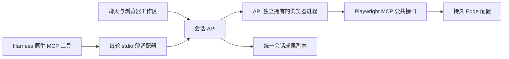

# V2 通用浏览器设计与验证

日期：2026-10-14。当前是已运行的浏览器增量；整个 V2 Goal 仍在实施。

## 架构

Harness 继续负责模型/工具循环。campus-browser-mcp.mjs 只是标准 MCP 服务，将浏览器发现/执行请求转到已有的按轮授权网关，不重建 Agent。BrowserHost 由 API 懒启动，独立于每轮 SDK 进程；浏览器使用公共 launchPersistentContext 和 createConnection/contextGetter，内部通过公共 InMemoryTransport/Client 连接。

默认70项模型可见工具，示例计算 MCP 后71项。新增浏览器26项、MCP资源3项。按需发现仍是后续项，不能把“复用 MCP”说成已完成上下文优化。依赖严格固定；Playwright MCP 的声明返回 SDK1 Server，实际与 MCP2.2.0 公共客户端互通已经执行验证。

## 状态与文件

浏览器原生配置、私有动作记录和下载目录均在 CAMPUS_AGENT_HOME/browser。配置跨 SDK 轮次和浏览器正常重启保留；公开页面信息、预览和回执不包含运行时授权、原始 Cookie 或密码。

动作记录原子写入 actions.json，保存 pending/executing/executed/rejected/stale/uncertain。进程恢复遇到 executing，按结果不确定处理，不补发提交。普通读取记录不会启动浏览器或模型。下一轮只注入最近8项动作的 ID、状态和目标摘要，完整内容保留在动作记录；记录读取失败时其他任务可继续，模型会得到不得自行重复提交的提示。

一次确认的执行步骤：采集具体目标与字段→记录预览及私有状态指纹→用户确认→重新采集并比较→持久化 executing→执行一次→保存执行结果。修改内容/目标后旧记录失效；已经执行或不确定的记录不会被自动重放。执行成功不代表网站业务接受，需要页面回执证明。

普通 GET 搜索无需确认。标准表单的按钮覆盖地址只在确实存在 formaction 属性时采用，否则读取 form.action；真实 UI 验收发现默认 button.formAction 会错误返回当前页面，已据此修复。非标准网页动作提供显式预览工具，采集当前可编辑字段；不声称静态 DOM 检查能覆盖任意脚本副作用。

下载监听实际完成后才登记文件。API复制到现有 ConversationFiles，按下载 ID 防重，产生既有 file.published 事件；反复查询状态不反复复制大文件，不依赖模型记得调用 publish_file。源文件后续变化不改变成果副本。

## UI 与停止

useBrowserWorkspace 管理请求、状态和动作回执；BrowserWorkspace 负责展示。刷新会恢复待确认记录，执行后按钮消失并保留回执。用户可以打开独立窗口处理登录/验证码，也可以停止浏览器。改版无需改浏览器进程或 Harness 插件。

当前实际验证了作用于指定轮次的停止：关闭真实页面，使正在导航的调用失败，其他轮次的停止请求不误关当前导航。Root Runtime 仍立即写 cancelled，再异步收尾；任意 browser_run_code_unsafe、后台命令、跨轮子任务及全进程物理停止还需统一审计。不能将导航停止证据扩大成所有脚本都已停止。

后台浏览器转为可见窗口会重启上下文，保留登录配置，不保证当前表单 DOM/草稿。表单确认会重新校验；更顺畅的模式切换及后台任务恢复仍可改进。单人共享浏览器按请求串行执行，不是多人隔离浏览器服务。

## 验证证据

- 独立真实 Edge/Playwright MCP：var/v2-browser-Nrk0Ac/evidence.json，13项实际检查，包括 GET 搜索自动执行、表单/回车/网页按钮确认、变更拒绝、重复确认、Cookie/存储重启保留、下载字节、导航停止和快照凭据隐藏。
- 实际 API→Harness→MCP→Edge：var/agent-integration-svde00pc/evidence.json，70次受控模型调用，四项浏览器工具实际成功；附件自动交付；一次确认且重放不重复；下一轮读取实际回执。
- 实际 UI：var/agent-integration-b1ouspmg/browser-ui-evidence.json；390×844下内容宽390，真实确认目标与字段、刷新恢复、回执、可见窗口启动/停止、附件预览与实际下载字节通过。三份截图同目录。

受控页面模拟登录完成后的 Cookie，不替代真实校方账号/验证码试用；模型也受控，不替代真实官方模型任务规划验证。尚未完成持久 Goal/调度、旧系统迁移退役、全部取消语义、换布局/桌面全宽视觉/性能和最终干净安装。

公开接口依据：[Playwright MCP](https://github.com/microsoft/playwright-mcp)、[配置类型](https://github.com/microsoft/playwright-mcp/blob/main/config.d.ts)、[MCP TypeScript SDK](https://github.com/modelcontextprotocol/typescript-sdk)。实现固定已验证版本，不跟随 main 自动升级。
