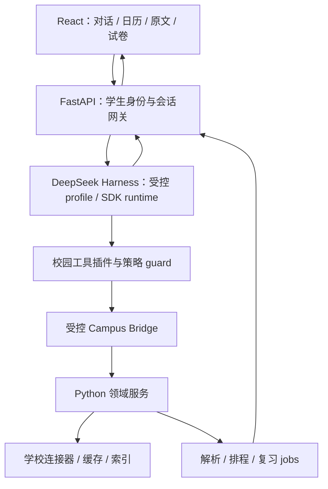

# 借鉴并接入 DeepSeek Harness

决策日期：2026-10-13。用户指定项目：[deepseek-ai/deepseek-harness](https://github.com/deepseek-ai/deepseek-harness)。结论：**优先复用 Harness 运行时，通过校园插件调用现有 Python 业务服务，保留自己的学生界面。** 先完成窄范围接入验证，再确定依赖版本和正式迁移。

本轮已阅读官方架构、工具执行管线、工具开发规范、工具与 PTC 子系统、sdk-minimal 说明及部分源码。浅克隆因连接重置失败，GitHub API 获取提交号遇到 403 限流；因此本文没有锁定上游 SHA，也没有声称安装、编译或联调成功。实施前必须补齐固定 SHA/版本与依赖锁文件。

## 1. 为什么适合这个项目

Harness 将模型、工具、会话和 Agent 循环作为可组合能力，并提供注册、事件与持久化扩展点。Campus Agent 正好需要把这些通用机制与校园业务分离。[官方架构](https://deepseek-harness.github.io/deepseek-harness/en/reference/)

我们的工程重点应转向：校园工具是否准确、工具文档是否容易被模型使用、答案是否可核验、用户能否少操作。会话循环、工具分发和流式事件不应再独立重复建设一套。

## 2. 复用范围

| 部分 | 方案 | 我们仍需实现 |
|---|---|---|
| Agent loop | 复用上游运行时 | 校园 system prompt、步数/费用预算、用户打断策略 |
| 工具注册与调用 | 通过工具插件注册 [36 项领域工具](tools.md)，按阶段启用 | API 适配、身份映射、严格字段与业务规则 |
| 会话与恢复 | 复用会话机制 | 会话到本地学生身份、课程上下文、业务 job 的映射 |
| 权限扩展点 | 复用执行管线与 guard | 账户范围、材料外发、计划版本和本地写操作授权 |
| 模型适配 | 复用满足需求的 provider 接口 | 配置迁移、默认策略、任务级费用上限 |
| 长任务呈现 | 接入运行时事件 | 既有 Python job 的状态/取消桥接，进度卡与恢复 |
| 对话前端 | 首期保留 React 学生界面，只接会话事件 | 来源、日历、计划差异、复习卷工作区 |
| 原文检索与计划计算 | 保留当前 Python 引擎 | 数据质量、语义检索、临时约束适配和评测 |

这是采用建议，表中“复用”不意味着无需适配。最新发布包使用 React；直接复制整个 Harness UI 会增加产品迁移范围，首轮没有必要。

上游 README 标明开发预览及可能破坏兼容性的改动，并标注 MIT。我们应保留必要许可证声明、固定依赖并把升级放入回归流程；不按浮动 master 自动升级。[官方仓库说明](https://github.com/deepseek-ai/deepseek-harness)

## 3. 推荐部署结构



推荐以独立 Node 运行时配合现有 Python 服务，使用官方启动/profile/SDK 机制进行接入验证。FastAPI 通过适配器转发消息、取消和事件；校园插件只调用固定本机地址下的明确业务能力。具体 SDK 调用签名和传输需按最终固定版本实现，本文不提供未经验证的可运行初始化代码。

两种状态必须分清：Harness session/turn 记录交互与工具调用；Python job 记录实际同步、解析或生成任务。`job_id` 归业务服务所有，Harness 只保存关联。停止当前模型等待不等于取消业务 job；用户点“停止生成”时需把取消意图传到对应 job。

身份桥接：可信网关将 Harness session 绑定本地主体；插件凭短期服务令牌访问业务层，令牌不进入模型参数或工具结果。FastAPI 再检查 ID 所属、能力范围、版本和授权。两个进程均按单机边界部署；仅绑定 loopback 不替代身份和请求校验。

业务读取走专门接口，禁止通用“请求任意 URL”桥接。学校 Cookie 留在既有校园连接器；不把 Harness 会话 ID 当校园身份，不直接复制浏览器会话到模型运行时。

## 4. 内部调用方式

### 常规工具调用：第一阶段采用

```text
学生消息
  → Harness 组装会话上下文与本轮工具定义
  → 模型选择 campus_assignments_list
  → 工具管线：授权策略 + 不可绕过的业务 guard
  → Campus Bridge 验证/翻译输入
  → 现有 Python 查询服务
  → 结构化事实、来源、覆盖范围和时间
  → 模型组织回答；前端显示事实卡与来源
```

工具执行管线有调用前、执行和调用后扩展点以及最终观察阶段；校园权限使用不可被后续监听器放宽的 guard，不能只靠提示词，也不能只在 UI 隐藏按钮。[执行管线](https://deepseek-harness.github.io/deepseek-harness/en/reference/tool-execution-pipeline)

工具实现返回结构化 JSON；模型可见文本和前端展示分别由投影处理。`defineTool` 提供参数/结果支持，但其隐式参数根是开放对象，校园工具要求拒绝额外字段时仍需补严格校验；正数、长度、日期范围等也在适配器验证。[工具开发规范](https://deepseek-harness.github.io/deepseek-harness/en/reference/cookbook/adding-a-tool)；[schema 源码](https://github.com/deepseek-ai/deepseek-harness/blob/master/packages/core/tools/src/schema.ts)

不要只在展示文本中遮掉不允许披露的字段而让 canonical value 仍包含原文/密钥。原始值、输出投影、日志和回放都必须遵循资料范围。计划应用、模型生成的幂等键由运行时持久化，不由模型每次随意生成。

### 程序化组合工具：第二阶段评估

Harness 的 PTC 支持把工具作为程序绑定调用，且子调用仍经过工具执行管线；这适合批量查询和结果汇总。其运行时是可选部分，隔离与取消有明确边界。[PTC 文档](https://deepseek-harness.github.io/deepseek-harness/en/reference/subsystems/ptc-runtime)

我们可在只读链路验证稳定后评估如下组合，以下是说明性伪代码，不是本轮已运行代码：

```javascript
const assignments = await tools.campus_assignments_list({ course_id: "crs_1" });
const tasks = await tools.campus_tasks_list({ course_id: "crs_1" });
// 使用结构化字段关联，保留 partial、来源和时间精度。
// 不在这里直接写数据库、自动登录或应用安排。
```

首期选择常规调用便于检查每一步；后续 PTC 不得变成任意 Node/Shell 执行通道。对不支持的隔离要求应拒绝运行，不能从“代码执行成功”推断权限限制生效。

## 5. profile 与插件边界

新建项目专用 profile（建议名 `campus`），显式列出允许的运行时与工具插件。在固定上游版本后检查最终启动配置与模型可见工具集合，测试必须断言没有额外 Shell、任意文件写入或插件安装工具。

不要把 `sdk-minimal` 的名字理解成天然适合学生版。官方默认配置包含平台 Shell，并采用高权限策略，还省略若干产品能力；我们需要的是校园最小能力集合。可参考其显式组合方式，但应构建经过审查的校园 profile。[sdk-minimal 官方说明](https://github.com/deepseek-ai/deepseek-harness/blob/master/packages/bundle/sdk-minimal/README.md)

建议只维护少数业务插件，避免每个小函数都形成一个复杂包：

- `campus-tools-read`：连接状态、课程、作业、资料与当前安排。
- `campus-tools-planning`：可用时间、任务反馈、方案预览和应用。
- `campus-tools-learning`：复习材料、生成、修订和导出。
- `campus-tools-campus`：教务、学院通知与旧版身份适配。
- `campus-policy`：授权、对象版本、预算、结果范围。
- `campus-context`：当前课程/材料、时间、任务关联和上下文压缩后的恢复。

插件是实现组织方式；[工具文档](tools.md) 才是模型可用能力的准确说明。工作流手册可转成经维护的领域指导文档，不能包含新增权限或信任外部通知里的操作指令。

## 6. 前端和证据卡

第一阶段保留 React 页面组件，将对话放在主入口，卡片只引用已经鉴权的业务对象。原文、课表与试卷按上下文打开。SDK/网关适配负责将 Harness 事件转换成前端稳定协议，不能让每个页面自行理解运行时所有事件。

若将来采用 Harness Web Client，则按其客户端插件机制新增卡片。官方明确区分宿主的工具呈现与 Web Client 的工具视图插槽；只实现宿主 presentResult 不等于 Web 上出现自定义卡片。[Web 呈现规范](https://deepseek-harness.github.io/deepseek-harness/en/reference/cookbook/adding-a-tool)

这是避免后续返工的接口边界：我们定义的是校园卡片数据协议，不将 React 组件 props 塞进通用工具结果。会话重放时，已失效来源显示失效提示，不能自动取新版本冒充当时的依据。

## 7. 最小接入验证

在单独分支/临时数据环境完成以下验收，暂不迁移真实学生数据库：

1. 固定上游 SHA/包版本，能重复构建启动；记录使用的 Node/Python 版本与许可证。
2. 只注册 `courses.list`、`assignments.list`、`materials.search`、`materials.read`、`plans.read`，用合成数据完成带来源的两轮问答。
3. 验证工具额外字段、其他主体 ID、过期对象与未知能力被拒；prompt injection 不能引出未注册能力。
4. 验证用户打断、断线重连、会话恢复，清楚区分 turn 与后台 job。
5. 接入 `plans.preview/apply`，展示具体方案后应用；重复请求、旧版本与恢复时都不重复写入。
6. 接入一个复习生成 job：核对授权的材料快照、幂等、费用范围、取消和旧结果保留。
7. 比较调用正确率、完成耗时、模型 token 和手工操作数。未通过前保留旧界面可用入口。

通过后以 Harness 为默认 Agent runtime，不再自研通用 loop。若 SDK、打包或本机资源占用不满足需求，保留领域工具契约，更换运行时适配；不要反过来让学校业务代码依赖 Harness 内部私有类。

## 8. 对原设计的修订

[产品与技术设计](product-and-architecture.md) 中的“编排、注册、会话”是逻辑职责；采用本方案后主要由 Harness + 校园插件承担。Python 新增的是领域服务桥接、对象授权与版本校验，不另写一套平行 Agent 循环。

不必整包复制上游仓库、不必先把全部现有功能改成 MCP、不必默认引入多 Agent 或 PTC。首要交付是：学生提出一个校园目标，运行时正确组合已经存在的工具，在同一个会话里完成它。
