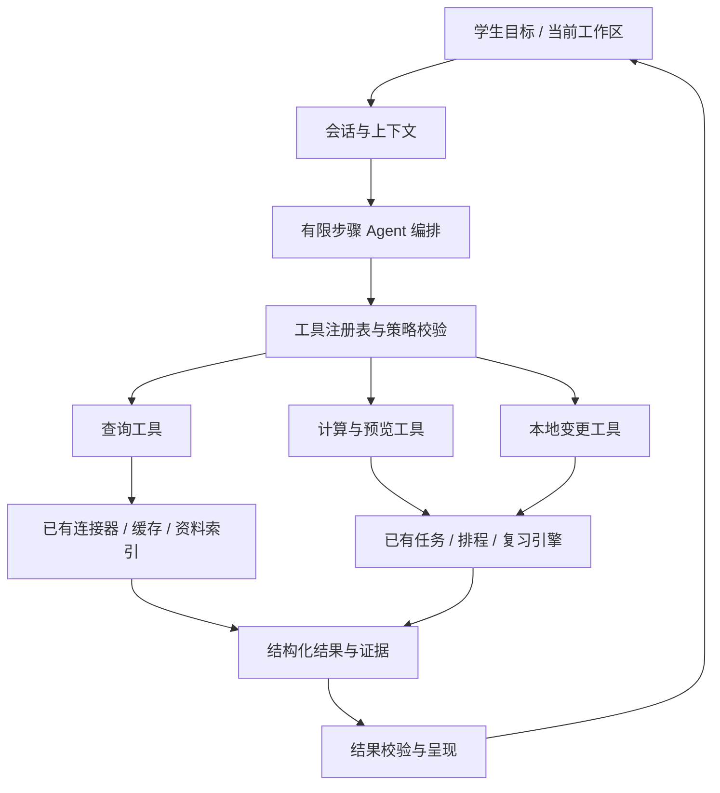

# Campus Agent 产品与技术设计

版本：设计提案 1.0 / 2026-10-13。与 [工具文档](tools.md)、[编排手册](workflows.md) 配套。所有新组件、工具名与接口均为拟议设计。

运行时选型更新：按用户指定，优先采用 [DeepSeek Harness 接入方案](deepseek-harness.md)。下文的注册、编排和会话是架构职责，由 Harness 与校园插件承担；Python 保留领域服务和权限校验。

## 1. 产品定义与范围

Campus Agent 是理解学生目标、调用校园与学习工具、返回可追溯答案和可调整方案的个人助手。

长期愿景是覆盖大部分校园问题。首轮范围明确限制为已连接的课程、作业、资料、课表和试点学院通知；其他问题说明缺失来源，并给出已有的官方入口或请求补充材料，不能猜造学校政策。

第一批优先问题：

- 今天、这周有哪些与我有关、需要采取行动的事？
- 某项作业、通知或课程资料究竟要求什么，依据在哪里？
- 在我的可用时间内，怎样安排任务，改动会影响什么？

复习卷作为随后接入的产物能力，不能占据首次使用主流程。

## 2. 交互原则

1. **目标先行。** 先问问题，缺少数据时再邀请连接或导入；不要求先完成全部配置。
2. **系统处理流程。** 同步、解析、检索、任务生成等由 Agent 按需调用；用户不需要知道模块顺序。
3. **结论先行。** 先给答案、日期与下一步，随后给来源和覆盖范围；不要只返回一堆原文让用户重做整理。
4. **图形界面承担适合直接操作的部分。** 周课表、材料勾选、计划差异和试卷保留专用展示，和会话共享状态。
5. **渐进呈现。** 默认只显示当前决定需要的信息；技术日志、完整参数、版本详情按需展开。影响结论的缺失来源和未知截止不能折叠掉。
6. **不把减负变成反复确认。** 已授权的读取和可撤销的明确指令直接执行；只在缺失关键条件、新增外发范围或未授权的具体变更上请求决定。

## 3. 信息架构与首页

常驻入口建议为“助手”“安排”“资料”；设置位于账户菜单。安排聚合课程与生效计划；资料按课程/事项聚合，包含复习产物。辅助页面可保留深链接。

首页只保留三种主体：会话、最多三条有行动价值的近期事项、输入框。不再把资料数量、任务总数、宣传大图和模型技术选项放在主视觉。

```text
┌────────────────────────────────────────────────────────────┐
│ Campus Agent       助手   安排   资料          账户 / 设置  │
├────────────────────────────────────────────────────────────┤
│ 今天需要关注：2 项截止，1 项时间待核对     [查看安排]        │
│                                                            │
│ 你：我今晚只有一小时，先做什么？                            │
│ 助手：建议先处理……                                         │
│ ┌ 任务 A · 周三 18:00 截止 · 预计 40 分钟 ──────────────┐   │
│ │ 推荐原因…… [查看依据] [加入今晚安排]                   │   │
│ └──────────────────────────────────────────────────────┘   │
│ 已依据当前课程作业和学院通知；另有一个来源尚未更新。         │
│                                                            │
│ [＋] 继续提问，也可以添加资料……                    [发送]   │
└────────────────────────────────────────────────────────────┘
```

此为合成线框示意，不是当前真实学生数据。桌面按需在右侧打开原文、日历、计划或复习卷；手机进入全屏工作区，返回时保持会话位置、草稿与上下文。输入框始终容易找回，不能被长表单永久替换。

### 回答结构

默认格式：直接结论 → 至多三条主要依据/事项 → 一个最相关动作 → 来源与覆盖说明。不是所有回答都强制卡片；一句话能回答的问题保持简短。

- 时间：区分报名截止、活动开始、集合时间和模型估计，不用 23:59 补齐未知时刻。
- 状态：区分平台已提交、本地学习完成、候选待办、已应用计划。
- 不确定性：优先指出影响用户行动的缺口，如“地点只在未解析附件中”。
- 来源：事实就近关联来源 ID、版本、页码/段落/时间轴；侧栏一键核对。

### 首次使用

首页直接允许提出目标；展示“连接课程平台”“添加资料”两个上下文选项，不先展示七个模块的教程。模型未配置时可以查看事实和使用确定性工具，明确说明智能整理未启用。技术试点可由用户在设置配置密钥；面向普通同学的免配置模型服务需另立部署、费用和数据处理方案，不能假定现有本地应用已经具备。

## 4. 将流程拆成工具，而非把页面改名为 Agent



工具是有类型、有边界、可测试的业务动作，例如 `materials.search`、`plans.preview`。工作流是多个工具的组合，例如“安排这一周”。模型决定使用哪些工具、组织答案；服务端决定权限、版本、事实计算与写入是否成立。

工具层先做 Harness 插件到现有 Python 服务的受控适配。是否增加 MCP 是后续复用需求，不是实现 Agent 的前置条件。模型不能拿任意 URL、SQL、文件路径或 shell 命令绕过工具层。

### 编排规则

1. 获取用户目标、当前时间、当前课程/资料/方案 ID；把“这门课”“刚才那份通知”解析为已有对象。
2. 按意图加载相关工具组，不把完整目录和所有资料每轮塞给模型。
3. 先查本地事实；只在授权范围内补同步。来源缺失与“没有待办”必须区别。
4. 工具返回后校验类型、来源、版本、时间精度和覆盖情况；不凭工具名称宣布成功。
5. 出错时局部降级或返回可恢复操作；保留已完成步骤，避免从头重跑。
6. 单轮建议上限 8 次工具调用、2 次可恢复读重试；为初始工程预算，需实测调整。登录失败不自动重放凭据；有副作用的调用超时先查询结果。
7. 长任务转成持久化 job，先回传进度卡；后台事件更新同一张卡，不连续追加刷屏消息。重连后按 job ID 恢复。

## 5. 上下文与证据模型

新增会话状态：`conversation_id`、`turn_id`、当前课程/事项、用户明确偏好、待应用方案 ID、任务关联、授权范围。服务端绑定主体身份；模型输入不能声明其他 owner。

统一结果中的 evidence：`source_id`、`source_system`、`entity_id`、`version`、`locator`、`fetched_at`、`coverage`。全文只按相关性和预算读取；课程名不是内容证据，标题匹配不能冒充已读附件。

实体映射使用 `(source_system, external_id, term)` 等稳定键。同名课程不可自动合并；通知的不同版本保留引用关系。保留原生 task、assignment、notice、course 类型，仅在“安排”视图汇总，避免把所有通知都强制变成学习任务。

缓存：每类源单独记录更新时间、查询范围、分页是否完整、部分失败。新同步结果不能让旧来源自动变成“最新”。本地应用关闭期间没有后台同步承诺。

跨实现迁移：发布包以 `var/personal.db` 为本地个人数据库，旧版有独立 owner 体系；先做显式账户映射与服务适配，禁止把旧版 owner 作为新库天然支持多用户的证据。首期保持单机个人范围；迁移工具仅在备份副本验证，不能直接对用户数据库试错。

## 6. 权限和成本应按动作处理

| 动作 | 处理方式 |
|---|---|
| 已连接范围内的查询 | 直接执行；返回覆盖与时效 |
| 用户明确要求刷新 | 在已有权限内执行；需要登录时打开官方登录流程并暂停依赖步骤 |
| 读取新附件或向模型发送资料 | 核对用户授予的资料范围和外发范围；超出范围才请求追加授权 |
| “把这项标记完成”等明确本地修改 | 目标唯一、版本有效时直接执行并提供撤销；不重复问同一句 |
| “帮我安排一下” | 先产生具体方案；应用时依据用户已给授权或就地接受方案，不能暗中覆盖现有锁定安排 |
| 付费生成复习卷 | 先完成材料/模型预检，显示预计范围与耗时/成本信息；超过已设预算或新增外发才请求决定 |
| 学校平台提交、报名、发消息 | 首期不注册这类写工具；不要输出虚假成功回执 |
| 删除、解绑、密钥管理 | 使用独立设置流程和具体对象确认；密钥与校园凭据不进入模型参数 |

授权记载由服务端生成，绑定主体、动作、对象版本、发送内容摘要和有效期。不得接受模型自填 `consent=true` 或 `approved=true` 作为授权证据。确认卡只是用户授权入口，不是取消服务端校验的通行证。

成本预算按任务类型分配，问答不能继承正式复习卷的高输出预算。优先使用结构化查询和已有摘要；内容版本未变化时可复用分析。模型供应商、限额与外发策略集中设置，学生无需每轮选择 OpenAI/DeepSeek 或规则/模型。

## 7. 实施顺序和代码落点

以发布包学习工作台作为建议主实现基线，待其源码纳入版本控制后推进；这是技术建议，不是本轮已经执行的合并。

| 阶段 | 具体交付 | 通过条件 |
|---|---|---|
| M0 基线整理 | 展开源码分支、版本与包清单、能力与验证台账、保存旧版增量 | 任一安装包能追溯源提交；没有覆盖用户数据 |
| M1 只读 Agent | Harness 固定版本接入、校园工具插件、查询适配、会话网关、证据卡；课程/作业/资料问答 | 前两个高频场景在对话内完成，失败说明准确 |
| M2 安排闭环 | 任务与可用时间工具、计划预览/应用/撤销、版本检查 | 跨轮“改到明晚”可基于同一方案继续；重复请求不重复应用 |
| M3 校园信息整合 | 教务与通知适配、账户映射、覆盖与时效统一 | 未支持学院不伪造结果；事实不混入其他账户 |
| M4 复杂学习产物 | 复习预检/生成/修订工具、原文和试卷工作区 | 长任务可恢复，范围与成本可见，结果能追溯材料 |

建议新增 `apps/agent-runtime/` 保存固定依赖与校园 profile，`packages/campus-tools/` 保存 Harness 插件；Python `apps/api/app/agent_bridge/` 保存会话映射、领域授权、适配与结果封装；前端 `features/assistant/` 加统一卡片协议。现有 routers 的业务逻辑逐步下沉到 service，HTTP 与 Agent 共用，避免业务规则复制两份。具体目录在源码基线整理后落实。

不要让前端 Agent 通过浏览器模拟点击来调用自家后端，也不要让已有路由授权检查因改成内部函数而失效。先建立少量工具的契约测试，再逐批接入。

## 8. 验收围绕信息负担

以下为建议目标，尚未实测：招募同一试点范围的 5–10 名学生，每人完成至少 6 个固定任务；新旧界面交叉顺序，使用等价数据，分别记录首次和熟悉后表现。

| 指标 | 定义 | 首轮目标 |
|---|---|---|
| 完成耗时 | 从提出问题到得到正确答案/保存有效方案，包含等待和人工核对 | 中位数比旧流程减少至少 30% |
| 页面负担 | 同一任务必须切换的独立页面数 | 查询类不超过 1 次；官方登录和查看原文另计 |
| 交互负担 | 为实现目标所需的手动选择/输入/确认次数 | 比旧流程减少至少 50%，不以省略必要授权达标 |
| 范围内完成率 | 基于明确支持数据范围，正确完成的任务比例 | 至少 80%；范围外问题单独统计 |
| 事实可追溯 | 被抽查的关键事实有对应正确来源和位置 | 每条必须可追溯；不能只验证 ID 存在 |
| 严重错误 | 错截止、错账户、未授权修改、虚假平台提交 | 发布门槛为 0；出现即阻断相关能力上线 |

必测用例：同名课程歧义、相对时间、无日期通知、附件未解析、部分分页、缓存过期、登录失效、模型失败、计划过期、作业已提交、双击和超时重试、资料删除后的引用失效、退出后迟到响应、外部文本诱导越权。

先以有标准答案的真实授权样本测试，再测开放问题。自动化通过不等于学生负担降低，也不等于校园平台覆盖完整。
