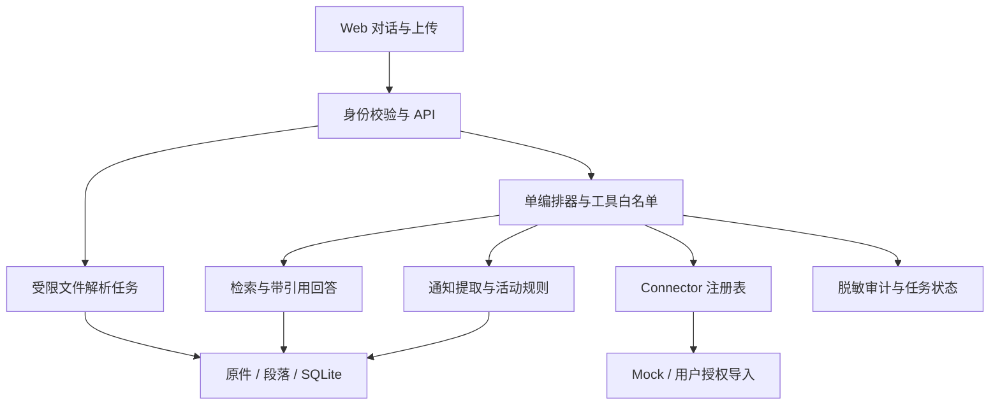

# 架构设计

2026-10-10 当前状态：本机通行证、ETA 六项基本信息及课表已进行一次本人测试账号联调，全套 158 项测试通过；接口超时/拒绝时保留缓存。正式授权、其他账号与整体试点验收仍需独立验证。以下保留原日期的阶段记录。

## 决策

2026-10-09 增量：加入独立的本机校园只读连接。`campus.py` / `campus_routes.py` 管理 CAS、教务会话与同步；`campus_snapshots` 按账号保存白名单字段快照。校园凭据不进入模型或文档检索。正式校方 SSO 注册和真实账号验收尚未完成，详见 campus-login.md。

通行证入口增量：`passport_routes.py` 负责浏览器绑定的匿名登录流程、验证后建立资料身份、首批自动同步及旧资料显式关联；`passport_accounts` 连接通行证登录标识与原 owner。浏览器会话用于默认恢复离线资料，CAS 会话用于实时换取已注册业务站点票据，两者生命周期独立。`static/passport.js` 处理自动续传、离线入口与旧资料绑定，详见 passport-login.md。

v0.2 已采用模块化单体：FastAPI + 原生 Web UI + SQLite。原件作为 BLOB 保存，解析在独立进程执行，页面轮询状态。单一业务路由调用本地检索、待办与 Mock 推荐；可选 OpenAI 仅生成带来源回答，不执行工具。原阶段 0 CLI 仍可独立运行。

当前核心实体为 users、sessions、documents、chunks、tasks、audit；以下 Course、CreditRule、Consent、ToolRun 等是后续设计，并未全部建表。多用户部署、可靠任务恢复及 OS 沙箱仍未实现。

## 数据契约

未来持久模型均含 id、owner_id、created_at、updated_at；原型仅包含 Source 和 Activity 的必要子集。

| 实体 | 核心字段与约束 |
|---|---|
| Document / Chunk | 文件 hash、格式、存储 key、页码/段落、解析版本、来源 ID |
| Notice / Task | 来源 ID、正文、deadline（可空）、原始时间文本、提取方法、确认状态 |
| Course / CreditRule | 学年、专业、类别、先修、替代关系、规则出处及版本 |
| Activity | 起止、报名截止、类别、名额、资格、学分、规则来源及有效期 |
| ToolRun | 请求 ID、身份、工具、参数摘要、状态、错误码、耗时 |
| Consent | 操作与参数摘要、有效期、单次 token、撤销状态 |

数据流：上传 → 校验 → 解析 → 按页分段 → 建索引 → 检索用户可见段落 → 模型生成 → 验证引用 ID → 展示。解析失败时记录原因，禁止返回“成功导入”。检索结果必须来自服务端权限过滤后的集合。

## Connector 契约

声明 id、operations、permissions、writable、auth、sync、errors、availability。正式接口建议 invoke(operation, params, context) 返回 records、cursor、fetched_at、warnings；context 的用户身份由服务端构造，不能信任模型生成的 owner_id。

错误分类：AUTH_REQUIRED、FORBIDDEN、RATE_LIMITED、UNAVAILABLE、INVALID_DATA、UNSUPPORTED。只读超时最多重试两次并退避；无权限不重试；写请求不能盲目重试。当前 Mock 为快照，无网络错误与增量游标实现。

## 编排与恢复

状态机：received → planned → running → succeeded / failed；未来写操作插入 awaiting_confirmation 与 verifying。每个步骤限制调用次数、时长和输出大小。模型只提出工具调用，由程序验证 schema、权限和配额后执行。

阶段 0 的 Agent.run 只实现关键词路由、只读函数调用和步骤标签，不实现 LLM 规划、可靠任务队列或持久恢复。正式版本分离工具计划和权限判定，不能依赖关键词作为安全策略。

## 扩展条件

只有写入并发、备份和运营需求明确时迁移 PostgreSQL；只有全词检索召回不足且有评测依据时增加向量检索；只有长任务恢复需求出现时引入持久任务队列。多 Agent、微服务和多校租户均不在当前范围。

2026-10-09：`academic_defaults.py` 独立提供原始学年/季学期参数兼容、有限探测范围、同学期缓存与默认日期规则。学业视图直接消费教务课程，日期可用性与官方核对状态分开；默认规则及事件 assumptions 可供未来模块复用，未接入模型。
