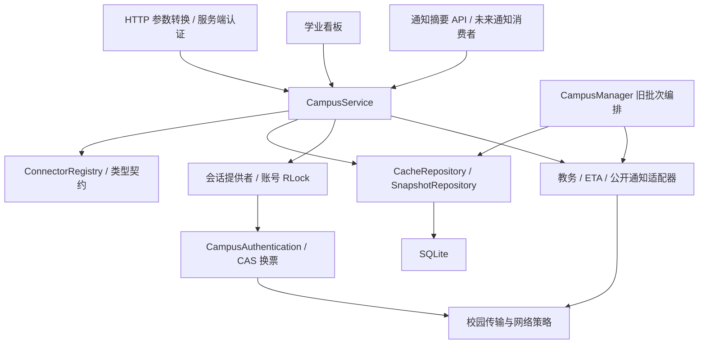

# 校园连接器与扩展指南

> **实现位置已迁移。** 连接器实现现位于 `connectors/campus`（旧 `campus_agent` 包已退役，
> 其 `campus_agent.server`、静态界面与 `scripts/verify_*.py` 不再存在）。本文描述的能力、
> 边界与错误语义仍然有效；路径以 [campus-migration-v2.md](agent-design/campus-migration-v2.md)
> 为准。

更新：2026-10-12。采用 FastAPI + SQLite 模块化单体，不新增依赖或后台服务。

## 当前可用范围

| platform_id | 能力 | 认证 | 本轮验证边界 |
|---|---|---|---|
| `zdbk` | `courses`、`grades` | 本人 CAS + 独立教务站点会话 | 现有协议迁移与合成回归通过；此前 10-10 有一次本人联调，本轮未重新登录真实账号 |
| `eta` | `profile` 六项本人基本信息 | 本人 CAS + 独立 ETA 站点会话 | 现有协议迁移与合成回归通过；此前联调记录保留，本轮未重新登录真实账号 |
| `zdbk_public` | `notices` 公开近期/置顶通知摘要 | 无校园认证；本地 API 仍需资料账号认证 | 本轮真实无 Cookie 读取成功，6 条记录；缓存、断开、重启读取闭环通过 |
| `ckc_public` | `college_notices` 竺院通知正文、附件链接 | 无校园认证；服务端按账号学院匹配 | 真实读取 3 篇正文、7 个附件链接，离线/断开/重启验证通过；当前仅竺可桢学院，见 [学院通知](college-notices.md) |

公开校历继续使用 `CalendarClient`，网络策略已统一。它包含 PDF/OCR、校方来源交叉核对及降级日期，不在本轮强行转换为简单列表连接器。资料检索、上传待办和 Mock 活动推荐保留原实现。

院系通知的 `selection` 由服务端学院缓存构造，不接受调用方指定学院或 URL；新公开页面网络策略独立由 `CAMPUS_PUBLIC_NETWORK_POLICY` 管理，默认跟随系统。学院通知可显式保存到既有资料/待办流程，不会因查询或同步自动建立个人待办。

没有创建作业、活动、智云的空连接器或模拟平台数据。这些方向未取得可复现的数据端点、本人权限范围、分页语义及正式开放接口依据；后续需平台文档或经本人授权提供的脱敏协议证据、测试账号/网络条件，必要时需学校应用授权。公开网站入口不代表开放 API。本次选择了可直接验证的公开教务通知摘要，因此其余方向未开展私有端点探测。

## 依赖与职责



* `connector_contracts.py`：明确查询类型、记录白名单、结果、错误码、连接器元数据和 Repository/SessionProvider 协议。只定义已实现能力。
* `campus_service.py`：能力和权限选择、缓存查询、范围组合、显式同步、保留旧记录、平台操作限流。不允许调用者提供身份、URL、Cookie 或登录参数。
* `connectors/zdbk.py` + `zdbk_protocol.py`：教务能力、参数与响应解析、分页和平台错误；`connectors/eta.py` + `profile_protocol.py`：ETA 本人表单、编码与错误；`connectors/notices.py`：公开固定列表摘要。适配器不导入数据库、FastAPI 或前端。
* `profile_fields.py`：两平台已共同使用的六项基本信息白名单与规范化，避免适配器互相导入私有实现。
* `campus_auth.py`：原 CAS 加密、一次密码提交、验证码与受信任业务票据交换。认证失败不切换网络通道、不重复提交密码。
* `campus_network.py`：TLS、Cookie 发送隔离、禁用自动重定向、网络策略、请求期限、响应上限和按站点共享限流；`campus_endpoints.py`：已审核的服务地址及请求配置。适配器负责解析响应和发现分页。
* `campus_repository.py`：明确的快照和能力缓存实现；`storage.py` 只新增表。服务通过 Repository 读写缓存，适配器只接受注入的会话/传输。
* `campus.py`：兼容 `CampusClient` 导入与原分批同步入口，提供现有账号锁、会话生命周期及学业看板编排。旧全学期同步保留；新业务使用 `CampusService`。`campus_profiles.py` 仅保留兼容导入。

## 统一调用

应用实例中使用 `app.state.campus_service`。内部入口返回 `QueryResult`；HTTP 输出使用 `model_dump(mode='json')`。

```python
from campus_agent.connector_contracts import UserContext, CoursesQuery, GradesQuery, NoticesQuery

# 示例一：课程规划或学业看板。authenticated_account 必须来自服务端认证。
context = UserContext(authenticated_account['owner'])
courses = campus_service.query('courses', CoursesQuery(year='2026', semester='3'), context)
grades = campus_service.query('grades', GradesQuery(), context)
# 根据 records 与 completeness 提供只读规划依据，不能推断官方毕业资格。

# 示例二：通知模块。日常读取不触网；由用户显式更新才请求公开来源。
notices = campus_service.query('notices', NoticesQuery(), context)
updated = campus_service.sync('notices', NoticesQuery(), context)

status = campus_service.connection_status(context)
campus_service.disconnect('eta', context)  # 只清 ETA 站点会话，保留缓存及 CAS/教务
```

实际接入消费者：`CampusManager.academic_view` 经统一服务读取课程和成绩，保留学期目录与校历语义；`GET /api/campus/notices` 经统一服务读取通知摘要。未来 Agent 工具可封装同一入口，但本轮没有把校园数据或凭据交给模型。工具应在服务端构造 context，并固定允许的能力、参数、用户权限，不能让模型指定 owner、URL 或 Cookie。

`query` 始终读取持久缓存，包括过期缓存，不自动换票、提交密码、检查网络或发起交互登录。`sync` 才显式请求远端；可利用仍有效 CAS 换取已审核站点的票据，不能重新提交密码。`platform=` 可选，只能选择注册表内支持此能力的实现。未知平台/能力返回 `UNSUPPORTED`；类型错误为参数错误，HTTP 400，响应不回显参数值。

课程 `year` 为学年起始四位年份，`semester` 保留学校原始学期编码，必须一起给出。单能力课程同步先读取真实选项并使用原 `query_year`，不将年份范围改写为猜测参数。不提供范围的课程 `query` 合并已知缓存；无范围 `sync` 返回 `UNSUPPORTED`，全学期同步仍走原批次入口。成绩与基本信息查询无客户端身份参数。通知 `limit` 为整数 1–6，范围独立缓存，不接受历史游标。

## HTTP 入口

| 方法与路径 | 行为 |
|---|---|
| GET `/api/campus/connectors` | 元数据及内存会话状态；不做网络可达探测 |
| GET `/api/campus/query/{capability}` | 默认缓存读取；如 `?year=2026&semester=3`，可指定 `platform` |
| POST `/api/campus/sync/{capability}` | 显式同步，JSON `{"query":{},"platform":"zdbk_public"}`；需要本地认证、CSRF 和同源保护 |
| GET `/api/campus/notices` | 通知业务的默认缓存入口 |
| POST `/api/campus/disconnect/{platform}` | 撤销该站点内存会话，保留校园缓存和上传资料 |

既有 `/api/campus`、登录、课表续传、校历和 `/api/campus/academics` 保持响应兼容。原 DELETE `/api/campus` 的前端语义是“断开并清除校园数据”，继续删除校园快照及新增能力缓存，保留上传资料。退出本地账号清所有在线校园会话、保留校园缓存；清除全部资料同时删除新增能力缓存。公共来源没有登录会话，disconnect 是无凭据清理操作；公共元数据声明不意味着已经探测网络可达。

## 数据与同步语义

结果含 `records`、`source`（能力来源标识）、`platform`、`fetched_at`、`last_attempt_at`、`freshness`（fresh/stale/unknown）、`completeness`（complete/partial/unknown）、`next_cursor`、`warnings`、结构化 `error`。记录 `source` 是受约束 HTTPS 依据地址，拒绝票据、账号口令及未知查询字符串；通知 URL 仅允许公开 `xwbh` 业务 ID 和固定 `doType=save`。ETA 基本信息保留逐字段来源与获取时间；旧混合资料只把 ETA 来源字段投影到 ETA 能力，避免把教务字段冒称为 ETA。本科成绩增加 `selection_id` 保存原始 `xkkh`，成绩、学分、绩点保持原文本。

`fetched_at` 为最后成功读取时间，失败不改写；`last_attempt_at` 在每次显式尝试记录并持久化。六小时以上缓存标记 stale；保留旧行的混合结果也标记 stale，新行有自己的获取时间。新成功但空结果遇到非空缓存时，不撤销已知记录，保留旧获取时间并标记 partial/stale；首次成功空列表可记录成功空范围。未知字段或不可信来源使整个本次结果明确失败，缓存仍可返回。

`connector_cache` 主键为 `(owner, platform, capability, scope)`，scope 是明确查询类型的规范 JSON，包括学期或通知条数。本地 owner 与通行证绑定沿用已有认证机制；旧手动校园身份切换同时清两种校园缓存。Repository 只保存业务记录和同步元数据，不保存密码、CAS token、Cookie 或在线会话。新表用 `CREATE TABLE IF NOT EXISTS` 自动创建，原快照按需只读兼容，无破坏性迁移。

同一账号的同步、会话刷新、断开与清除共用 RLock；不同账号的 CookieJar 和缓存独立。Cookie 发送按精确站点限制，CAS 父域主 Cookie 特例仅发往 CAS。一个站点过期只撤销该站点 Cookie/状态；超时和访问拒绝不是全部会话失效证据。公共通知传输完全不安装 CookieJar。

完整成功只替换对应范围；部分成功按业务身份合并，保留未返回记录和旧行获取时间。成绩旧快照缺少 `xkkh` 时按既有学期/课程信息升级，避免重复。课程范围缩小不撤销其他学期。平台中途抛错时暂不保存该请求的部分页，保留先前提交的快照；下次从第一页开始并去重，不能跳页或误标完成。

注册表声明分页/增量：教务成绩内部支持分页；它是有界全量分页读取，统一入口不暴露可恢复游标，`next_cursor=None`。重复/缺页返回 partial；20 页或 2000 条上限不能声称完整。旧课表续传仍有内存任务游标、六学期批次和原 UI；服务重启后该任务不可续，重新开始范围发现。未实现跨重启远端游标恢复或增量同步，所有适配器 `incremental_sync=False`。通知只读登录页范围，始终 partial，未实现分页或删除事件。

统一错误码：AUTH_REQUIRED、AUTH_EXPIRED、INTERACTION_REQUIRED、FORBIDDEN、RATE_LIMITED、NETWORK_UNREACHABLE、TIMEOUT、PROTOCOL_CHANGED、UNSUPPORTED。原平台错误在适配层分类，由标准映射转换；HTTP 429 优先识别限流，验证码与交互认证单独分类。调用者依据 code 处理，不能解析文案。统一输出错误使用固定文案，warnings 也只输出白名单摘要；异常原文、上游正文、代理地址和请求参数不进入日志。旧 UI 的细分安全诊断兼容保留。

进程内每站点最多 120 HTTP 请求/分钟，共享于不同账号及公开/登录连接器；能力同步另按 platform 最多 30 次/分钟，原登录与批次路由频率限制继续有效。每个现有会话保持请求间隔、请求超时和操作期限。当前不自动重试；只有未来明确安全的只读请求才允许有限重试，认证表单和服务票据不可盲目重放。

## 网络配置

启动前在 PowerShell 设置 `$env:CAMPUS_NETWORK_POLICY='system'` 或 `'direct'`；重启服务生效。默认保留历史 direct，不能理解为所有校园访问都应禁用代理。构造客户端时也可显式注入 policy 以便测试。

system 使用 urllib 的系统/环境 HTTP(S) 代理策略；direct 只对校园 opener 使用空 ProxyHandler。均不修改操作系统代理、DNS、路由，也不改变 OpenAI 客户端。两种方式仍服从系统路由，direct 不能保证绕过普通 TUN；校园网、aTrust 等客户端的路由能力需用户网络实际提供。浏览器 WebVPN URL 重写和会话不在支持范围，需要独立适配，不能继承浏览器登录。没有携带校园凭据的自动连通性检查；`connection_status` 只反映内存会话事实及已配置公共能力，不能证明远端实时可达。失败不切换通道，不重复密码。

## 新连接器开发步骤

1. 核实实际数据来源、只读端点、权限、真实样本和分页停止条件。记录官方依据与本机验证，缺少条件时不注册空实现。
2. 已有能力复用 Query/Record；新能力只添加实际需要的最小严格类型。拒绝 owner_id、任意 URL、Cookie、未经约束的扩展字段。来源地址须纳入审核白名单，不放宽为全网 URL。
3. 新增独立适配器，声明 `ConnectorSpec` 并实现 `fetch(capability, query, session) -> FetchResult`。仅负责固定 URL、参数、解析、分页和错误，使用注入传输；禁止 FastAPI、SQLite、前端和别的平台私有解析器依赖。
4. 在 `CampusService` 默认组成处注册适配器；复用能力也可 `registry.register(adapter)`。公共能力不需改会话提供者、旧适配器或前端分支。新受认证站点还必须审核 CAS service/回调及精确 Cookie 域，扩展会话提供者的受信任注册；不能因共用 CAS 就复用其他站点全部 Cookie。
5. 用合成响应和模拟 opener 测解析、错误、账户隔离、范围隔离、空/部分/分页失败、重复同步及来源/异常脱敏。不要只测试类存在，不依赖真实账号或联网运行 CI。
6. 单独运行本人授权的真实只读验证，记录日期、网络策略、范围与遗漏；只有模拟通过不能标为真实可用。公开验证可运行 `python scripts/verify_public_notices.py`，它只触达固定无凭据列表，并使用临时本地用户/数据库，不读取现有用户资料。

最小实现参考 `connectors/notices.py`；注册及业务入口参考 `campus_service.py`；行为测试参考 `tests/test_connector_service.py`。常见错误是 HTML 200 被当作已登录、把登录页摘要当全量历史、缺页误标完整、清掉未返回行、猜测原始学期编码、把异常原文或 SSO URL 写入来源、给适配器数据库或模型身份权限。

## 验证记录

2026-10-12 11:14（Asia/Shanghai），本机 direct 策略，真实无 Cookie POST 公开列表取得并解析 6 条通知。统一 sync 写入临时 SQLite；随后阻断 opener，query、公共 disconnect 后 query、重建 Manager 后 query 均保留同样记录，无网络操作。机器可读证据见 [本轮公共验证](connector-validation-2026-10-12.json)。无校园凭据、无真实账号操作、未读取通知正文或历史；学校响应可能改变，这不是学校开放 API 或正式合作资格。

自动化用模拟传输与合成资料，**183 项 Python 测试通过（含新增 21 项）**，前端认证回归通过，diff 检查通过。完整命令：`.venv/Scripts/python.exe -m unittest discover -s tests -v`。真实教务/ETA 迁移后的登录与其他账号、其他网络策略尚待本人单独验证，不能以原账号记录或本轮合成测试替代。本次未做新增通知前端展示、个人通知、作业、活动、智云、跨进程增量同步或学校正式 SSO 应用接入。
