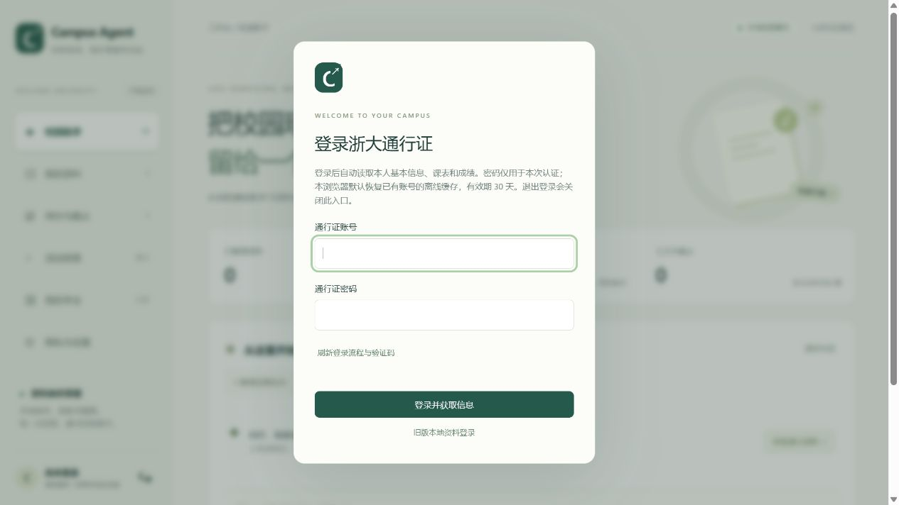
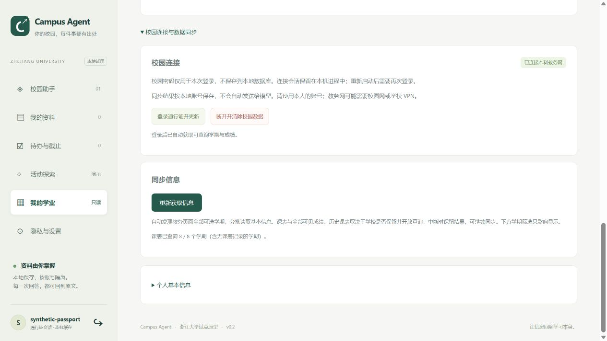
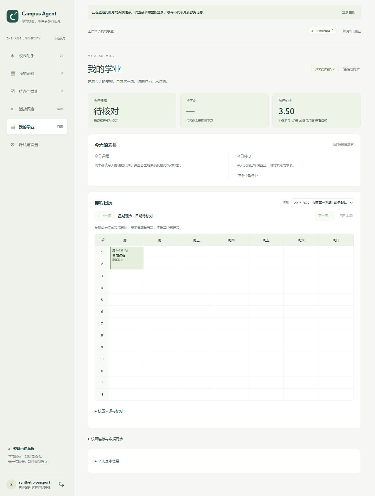

# 通行证登录、自动获取与默认离线缓存

2026-10-12 修复：连接器隔离改造曾拒绝校方登录页签发的父域 `_csrf` Cookie，可能破坏认证上下文。现在先验证 Cookie 的原始域合法性，再按实际签发站点绑定，CAS、教务和 ETA 的同名 Cookie 不覆盖、不跨站发送。公开匿名检查确认 CAS 请求保留 `_csrf`、其他站点不携带该 Cookie；未用真实账密重复登录，因此不声称已验证本次真实账号登录成功。

登录窗口现在始终提供“关闭 / 取消登录”，Esc 可关闭；关闭后左下角“登录”可重新打开。认证失败后只自动准备新的无凭据流程与验证码，必须本人重新填写密码/验证码后提交。网络等待有时限，关闭会中止浏览器等待并撤销对应后台流程，迟到响应不能重新打开窗口或切换账号。后台认证/首次同步期间取消，不建立新的本机会话，已有资料和原本机会话保留。极短时序中已签发的新会话也可按对应流程撤销；不会撤销同账号随后建立的新连接。

更新后先重启服务，再 Ctrl+Shift+R 强制刷新页面，`/api/health` 的 `campus_connector_revision` 应为 `2026-10-12.custom-status`。此前 2026-10-09 的主流程说明保留如下。

更新：2026-10-09。浙大通行证现在是主要登录入口。新的登录表单只填写通行证账号、密码和按需验证码；不再要求创建独立本地账号或再次填写教务登录表单。

## 登录与同步

首次登录先准备同一浏览器绑定的五分钟 CAS 流程。程序验证通行证后创建/读取该登录标识的本机资料身份，再即时换取本科教务票据、验证站内菜单权限并自动开始同步。首个请求最多查询六个学期，浏览器自动续传剩余批次；验证码、网络错误、权限拒绝等会暂停并显示具体阶段，手动“重新获取信息/继续获取未完成学期”仅用于刷新或恢复。

认证未通过不会创建资料身份、打开对应缓存或自动重试密码。通行证验证成功但某个业务站点不可用时，仍可进入本人资料并保留上次快照；教务连接及数据的失败状态单独标明。校历不可用时按同学期缓存或默认日期降级，标注来源；课程、成绩和个人身份不凭空补造。

课表参数兼容四位年份、相邻学年区间及数字/带季学期的原始值，不改写教务查询参数。选项发现失败时继续采用有限探测范围查询真实课表，保留成绩与已有课程，范围保持不完整；单学期或单行格式错误不再阻断其余可用课程。日期不再要求严格核对才能显示，采用“在线校历 → 同学期缓存 → 默认日期”降级。规则及适用范围见 academic-ui.md。

个人信息自动从教务个人页、ETA 本人基本信息表单和课表响应整合；来源失败保留已有缓存。每个字段保留来源与获取时间，课表续传不重复查询个人信息。协议与边界见 [ETA 适配说明](eta-profile.md)。

## 校园网络与代理

校园请求现集中支持 `CAMPUS_NETWORK_POLICY=direct|system`。默认保留既有 direct，仅校园 opener 忽略 HTTP(S) 代理；system 跟随系统/环境代理。需要代理通道访问校园服务时可在启动前设置 `$env:CAMPUS_NETWORK_POLICY='system'` 并重启。OpenAI 等其他模块网络行为不受影响。

直连仍使用操作系统提供的网络路由，可能依赖校园网或 aTrust 等学校客户端，不能保证绕过 TUN／虚拟网卡或透明代理。应按实际校园通道选择策略；程序不修改系统代理、DNS 或路由，不在登录失败后切换通道或重复提交密码。浏览器 WebVPN 需要独立适配，当前不能继承其登录。详情见 [连接器网络策略](connectors.md#网络配置)。

## 默认离线查看

成功在线验证后的浏览器持有随机 HttpOnly / SameSite=Strict 本机会话，最长 30 天；数据库只保存该随机令牌的摘要。下次打开页面先读取已保存资料，无需重新输入密码；进程重启、断网或通行证会话过期时自动标为“离线缓存”，保留来源和原获取时间。校园会话仍只保留在进程中最多一小时，不因本机会话有效而宣称校园登录态仍然有效。

无本机会话、会话过期、退出登录或清除浏览器 Cookie 后，不能凭输入一个学号打开缓存，需要重新在线验证。不会自动打开数据库中第一个账号，也不会以错误密码作为离线解锁方式。服务必须仍在本机运行；当前没有独立 PWA 离线壳。浏览器会话并非本机数据库加密，本机文件权限边界见 security.md。

## 多网站会话

密码仅提交一次给 CAS 认证，不保存密码，也不保存密码的本地校验哈希。CAS 主会话 cookie 保留在进程中，仅发送给 `zjuam.zju.edu.cn`；为业务站点申请即时使用的一次性 service ticket，再维护该站自己的 cookie。退出、断开或关闭服务会清除相关内存会话。

`CampusClient.service_callback(service_name)` 使用静态站点注册表，不接受任意 URL。目前注册本科教务 `zdbk` 和个人信息来源 `eta`；`connect_zdbk` 可用既有 CAS 会话更新教务登录，`/api/campus/reconnect` 不重复索取密码。其他网站仍需各自的已核查回调、协议、权限和数据适配；扫码、MFA、独立账号、OAuth/SAML 等不能由当前 CAS 方法一概代替。模型无权获得凭据、cookie 或票据；学业快照也未进入模型输入。

参照 [Celechron 的通行证会话缓存与即时换票](https://github.com/Celechron/Celechron/blob/724e54a3d8feb190a90544963cd53e8ef01c0ff9/lib/http/zjuServices/zjuam.dart)，本项目独立实现并限制业务站点范围。

## 旧版资料迁移

旧本地账号与资料保留，登录页“旧版本地资料登录”只用于原本地账号。在设置中点击“将旧版资料绑定到通行证”，验证通行证后将资料身份关联至当前旧账号，原件、任务及引用的 owner 不改变。绑定必须同时通过原本机会话和 CSRF 验证，不按用户名相同自动合并。任一方已关联另一个账号时明确拒绝合并。新通行证资料身份内部使用独立命名空间，不会占用同名旧账号。

同一人的不同通行证登录别名暂不自动合并；资料按实际成功验证的登录标识隔离。

## 验证

103 项测试通过，四个前端脚本语法检查通过。合成浏览器验证首次登录自动完成 8/8 学期、保留原始学期编码、重启后的默认离线缓存、认证服务不可用时继续查看缓存。修复首次未登录时两次并发准备造成流程 cookie 不一致的问题。真实学生账号仍需在本人本机联调；本次没有提交真实凭据。

