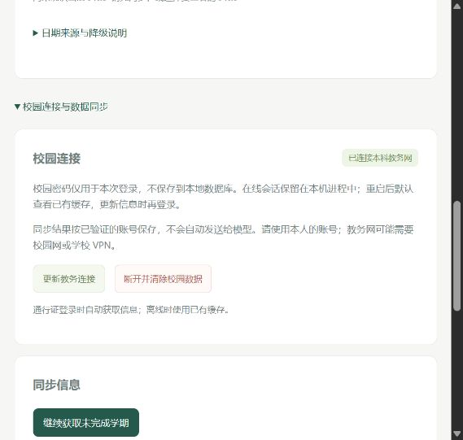
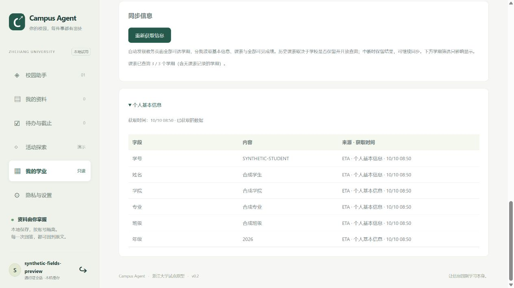
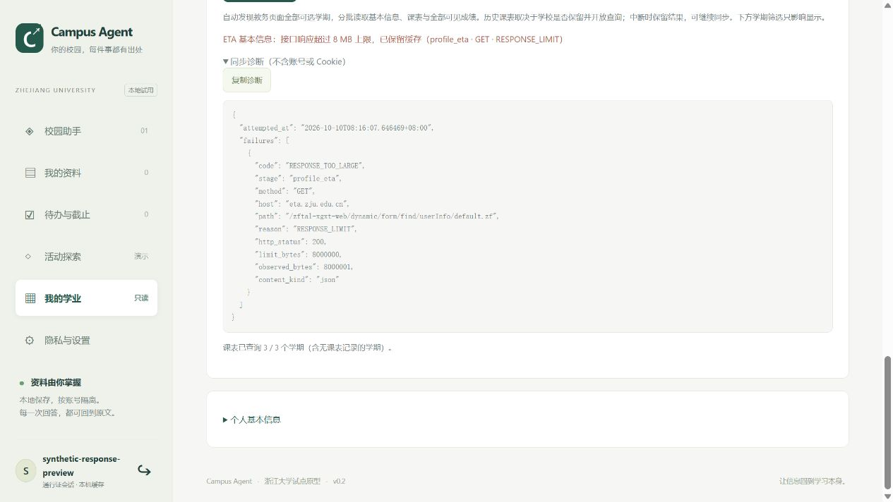
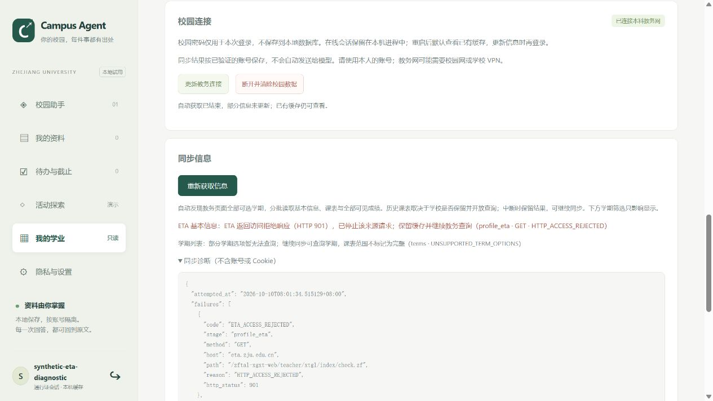
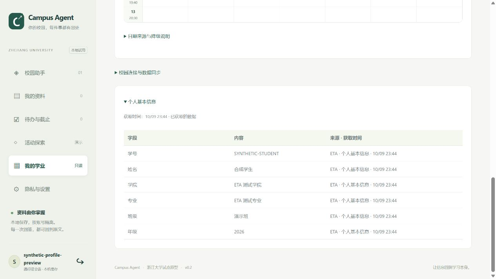
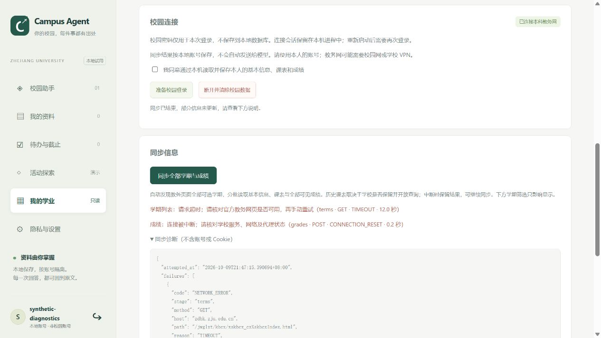

## 2026-10-10：课表缓存与稳定学期范围

修复成功空响应覆盖已有课程、同步进度误作缓存范围、部分保留行使用本轮获取时间的问题。持久保存 catalog，当前目录缩小时保留历史学期及课表，仅查询本轮开放项；中断、重启和网络失败继续使用缓存。已存在课程时空响应不删除，首次确实为空的学期仍保存；新有效非空课表正常替换。

新增六项回归：目录缩小且保留旧日期和学业视图、提供者缓存目录不被待查询队列消费、空响应保留及后续新课程替换、尚未查询的已知学期保留且不伪造课程、部分响应的缓存行保留原日期、重启恢复和账号隔离。全套 **158 项通过**，修改的两份前端脚本语法及 diff 检查通过。

隔离合成浏览器先取得八个学期，再返回一个学期且为空，确认保存数量仍为八、学期选择项均保留、原课程仍在日历、使用缓存及原时间说明可见。控制台无 error/warn。此测试未使用真实账号或学校网络。

## 2026-10-10：ETA 回调超时与会话复用

针对 11:14:30 的登录回调 TIMEOUT，修复每次同步重新换票的行为。已有站点会话先验证本人；明确失效才换票一次，网络/访问/协议故障不循环换票。ETA 请求等待调整为 20 秒，个人信息来源总预算 35 秒，均服从剩余操作期限。关闭时清除站点状态。全套 **152 项通过**，diff 检查通过。

新增六项回归：重复刷新不重复回调且每次核对身份、Cookie 复用及 CAS 标记过期后的站点独立使用、明确失效只换票一次/其他故障不换票、各站请求等待与剩余期限限制、首次回调超时不重试密码/票据、用户报告对应错误保留字段缓存和原时间且继续成绩课表查询。

隔离真实会话刷新确实跳过回调，但本人接口也出现 12 秒超时（测试进程传输层仍为旧等待），随后旧测试教务会话返回认证重定向，成绩接口返回 HTTP 922；没有因此断言其他账号或网络也存在相同拒绝。只读检查公开入口全部 200，ETA 公开认证配置耗时约 7.2 秒。未读取个人字段内容或 Cookie；没有以合成测试通过宣称真实校园网络故障解决。完整修复版本为 `2026-10-10.eta-session-reuse`。

## 2026-10-10：本人在读学籍与地址误映射修复

真实测试进一步发现 userInfo 的 jgdm 是籍贯，原代码错误填入学院；已取消该映射，并在识别该错误来源时撤回同一路径 ETA 学院缓存，保留独立来源。目录中明确存在 wdzd/default；公开前端 Wdzd 组件与 commonGrxx 定义流程相符。新增该本人学籍表读取，逐字段记录独立来源；不读取家庭、联系方式、学籍异动或其他学生记录。

保留当前测试会话加载解析修复，安全诊断确认学号、姓名、学院、专业、班级、年级六项全部 available、无基本信息警告。页面确认 21/21 个学期查询成功；未输出实际字段内容，未读取测试缓存或数据库，仅通过同步状态区域核对学期计数。本次没有再次输入密码即可刷新，验证了校园会话复用。正式服务完整修复仍需要重启加载 `2026-10-10.eta-academic-profile`。

新增四项回归，覆盖籍贯代码拒绝及错误缓存撤回/独立来源保护、发现的本人学籍表与字段来源、学籍表身份不一致/访问失败、声明实际值入口的本人参数与模块限制。全套 **146 项通过**，四个前端脚本语法与 diff 检查通过。

## 2026-10-10：真实平铺字段结构与超时续查

用户自行登录隔离测试服务；调试只记录固定路径、状态、响应字节数、容器结构和六个基本字段是否可用，不记录账号、字段内容、查询票据或 Cookie。真实 xsxg 返回 200 且成功，顶层 fields 包含 30 个字段，证实此前只识别 groupFields 的遗漏；没有读取真实快照或数据库进行分析。旧运行版本查询 11/21 个学期后，同一历史学期两次约 12 秒超时，本次未观测到之前的六次上游错误。

新增四项回归，全套 **142 项通过**。覆盖真实观测对应的平铺定义不触发 default 回退、平铺实际值声明与本人身份检查、单个超时保留缓存且不阻断后续学期、连续三次超时暂停及其他网络故障立即暂停。四个前端 JS 语法检查与 diff 检查通过。真实字段补齐与新版完整同步尚待重启后的本机登录验证。

## 2026-10-10：未解析表单回退与 HTTP 诊断

新增 9 项测试，全套 **138 项通过**。覆盖受限字典/JSON 文本包装、空外层 groupFields 不遮蔽内层定义、定义同行实际值、空 xsxg 回退到已知 userInfo/default 且保留本人参数、两表单不可解析时身份信息来源及准确错误类型、回退失败保留 CAS/教务会话、外层/内层/回退身份一致性、HTTP 500 在正文解码前分类、非 JSON 不导出正文/验证码、连续三次 5xx 暂停后缓存与待查询学期保存及手动续传。随后仅调整空包装选择并复测个人信息 **41 项通过**；前端脚本语法与 diff 检查通过。

09:57:23 用户诊断中学期编码警告消失，但 ETA 没有可识别定义，六项课表错误没有 HTTP 元数据；尚不能认定真正状态是 500。再次读取 Celechron 公开代码，确认本科完整学年区间与季学期参数原值用法，不凭错误码拆参数；ETA 原入口不可解析时额外使用公开前端中已知 default 表单，最多一次，不尝试其他学生或其他模块。

隔离浏览器模拟 xsxg/default 都不可解析和 HTTP 500：确认缺表单提示、诊断中的两次固定表单路径及课表状态/参数、自动查询在三次服务器错误后暂停、余下五学期仍可继续、成功计数与失败计数分开显示。控制台无 error/warn；只使用合成数据，没有真实账号联调。

## 2026-10-10：内联级联字段、字符解码与查询拒绝

针对用户 08:53:29 的 xsxg 内联表单缺字段、未知单字符后缀和无路径 UPSTREAM_ERROR，新增 10 项测试，全套 **129 项通过**。覆盖竖线组合字段的有序显示标签、实际值优先、错位标签拒绝、嵌套选项路径、内联配对名称、组合学号一致性、UTF-8/GBK 页面及错误编码声明、替换字符拒绝、单汉字学期原值查询且不猜季节、error=0/"0"/false/"false" 兼容、真实拒绝的安全元数据和验证码提示。四个 JS 语法及 diff 空白检查通过。

匿名读取 ETA 公开前端确认竖线 fieldCode 渲染分支，响应严格 UTF-8 解码成功（当前公开前端响应本身并非 GBK）；本次不能因此证明用户教务页面编码相同。没有获取真实表单、学生字段、票据或 Cookie，没有把真实故障归因于未经观察的响应值。

隔离浏览器验证旧缓存版本提示；合成内联表单首次缺少显示标签时只保留可识别字段，诊断显示 data_request=false 与脱敏 schema_shape；更新为完整级联标签后补齐六个基本字段并展示来源时间。控制台无 error/warn。未使用真实账号，实际 xsxg 结构及课表失败根因待本人更新后验证。

## 2026-10-10：ETA 表单实际值与运行版本

补上官方渲染器的 formDataUrl 第二步 GET；此前仅解析表单定义，可能漏读实际字段。新增 6 项测试，全套 **119 项通过**，四个前端脚本语法及 diff 空白检查通过。覆盖空定义/实际值填充、配对名与选项标签、实际学号与定义中自定义学号字段一致性、单记录读取、入口域名/路径/参数限制、空值与未识别编码、部分字段诊断，以及同步版本与旧缓存版本不被查看动作改写。

隔离浏览器使用合成账号自动读取三种双数字学期；首次实际值只提供学院和专业时，班级/年级行注明接口未返回可识别字段，诊断显示 data_request=true 与六个字段状态。点击复制出现成功提示；浏览器工具的剪贴板读取仍返回上次预览内容，未据此宣称本次内容回读一致。后续获取补齐六个字段并展示来源时间，控制台无 error/warn。没有使用真实账号或真实学生数据。

用户 08:38:57 诊断已无 ETA 超限报错，仍有未知学期；该记录没有运行版本/字段状态。匿名只读检查本机 8765 `/api/health` 仍是未包含本次连接器版本字段的旧响应，未读取该服务的个人接口、数据库或凭据。需重启原服务并重新登录生成新版诊断；没有替用户终止原服务。

## 2026-10-10：ETA 响应限制与双数字学期

新增 5 项测试，全套 **113 项通过**。覆盖登录页面无正文读取、超过原 2 MB 的 ETA 数据表单可解析且只保留六个字段、ETA 8 MB 超限诊断、访问拒绝先于读取正文处理，以及双数字学期原值查询、占位项过滤和不猜测编码季节。其他校园响应上限测试仍通过。新增“复制诊断”入口，复制安全元数据。

隔离浏览器验证三种双数字学期可显示、超限诊断含大小与固定路径，并成功点击“复制诊断”；读取回来的复制内容仅含安全元数据，控制台无 error/warn。数据和故障均为合成样例。

用户提供的诊断中，RESPONSE_TOO_LARGE 没有接口路径（旧错误遗漏元数据）；三个未知选项长度为 3、含竖线且不含季节字，与双数字编码结构相符，但尚未读取其真实值。新兼容按页面实际值查询，不把例子当成已确认编码。

## 2026-10-10：ETA 请求分类与学期编码兼容

新增 5 项测试，全套 **108 项通过**。覆盖 ETA 登录回调与数据接口请求头分别设置、不发送额外 AJAX 标记、901/922 立即停止来源、保留教务与 CAS 会话、状态/路径诊断不泄露票据，以及季学期后缀/组合编码原样查询和日期选择。四个 JS 脚本语法检查及 diff 空白检查通过。

隔离浏览器用合成账号验证了 ETA 901 后教务查询仍完成、失败阶段与固定路径可见、未知学期选项仅显示脱敏结构，并且控制台无 error/warn。

公开无凭据检测中，ETA 根入口、/xgxt 和 pd.zf 返回 200；这不证明用户浏览器看到的 404 已修复，更不证明真实票据回调不再返回 901。修正参考官方 Axios 请求声明及 zjuhelper 访问笔记，同时采用其审计补充：不能把所有 901 永久归因某个头或限流。

## 2026-10-09：ETA 与个人信息补全

新增 18 项测试，完整回归 **103 项通过**。覆盖当前及旧 ETA 编码（独立 Node AES 对照）、本人默认角色与表单发现、未登录 HTTP 200、身份不一致拒绝、字段显示标签、只保存六个基本字段、CAS 主 cookie 隔离、HTTP 注册回调仅升级 HTTPS、ETA 失败保留缓存、教务连接失败仍获取 ETA、登录自动补全与续传不重复读取、字段时间与缓存状态、重启缓存和账号隔离。四个前端脚本语法、依赖及 diff 空白检查通过。

隔离浏览器使用合成通行证登录，自动完成 8/8 学期；教务课表只返回姓名/学号，个人信息页仍显示 ETA 补充的学院、专业、班级和年级，并逐行展示来源与时间。控制台无 error/warn。没有使用真实校园凭据；实际 ETA 学生响应尚待本人本机验证。具体协议依据见 [ETA 适配说明](eta-profile.md)。

## 2026-10-09：课表参数兼容与可用性降级

85 项回归测试通过（新增 8 项）。覆盖真实参数形状 `2026-2027 / 1|秋` 原样发送、列表失败使用当次成绩学年查询、单行异常保留有效课程、单学期失败继续其他查询、校历缓存不因过期失去展示能力、默认日期/节次/缺失周次、秋冬学期选择以及不跨年复用假日和开学日期。四个前端脚本语法和 diff 空白检查通过。

浏览器使用合成账号、模拟缺失列表与在线校历不可用，自动完成 8/8 查询并展示今日一门课程（08:00–09:35）、日期周历、明确推算标签及课程详情；服务重启后无需再次认证即可默认查看缓存中的推算日历；没有读取或提交真实学生凭据。本次不能保证用户实际教务响应已全部适配，需在本机验证。

# v0.2 验证记录

## 2026-10-09 通行证入口与默认缓存

学期查询改为使用页面实际数字编码，忽略占位/全部选项；未处理选项不阻断可查询课表与成绩，范围仍标为不完整。新增通行证作为主入口，登录自动完成首批同步并续传；密码不作为本地密码哈希，CAS 主会话仅发认证域名，可即时换取已适配站点票据。默认通过本浏览器原会话恢复缓存，服务重启时显示离线状态；无会话、错误密码或另一个浏览器不能凭学号读取缓存。保留旧账号并提供显式绑定，不自动合并同名账号。

共 **77 项测试通过**，四个前端 JS 语法检查通过。合成浏览器实测通行证单一登录入口自动完成 8/8 学期、来源编码 1 的星期课表、服务重启后无需再次登录即可查看本人离线缓存、认证服务不可用时返回缓存界面；控制台无 error/warn。修复首次未登录时多个 401 触发并发准备、导致流程 cookie 不一致的问题。截图与具体边界见 [通行证说明](passport-login.md)。没有使用真实学生凭据，实际校园查询仍需本人验证。

## 2026-10-09 同步失败诊断

针对实际页面“已连接，但同步两条相同连接失败提示”，补齐教务 JSON 的 AJAX 请求头，分别展示学期列表、课表、成绩失败阶段；增加不含凭据的传输类别及请求耗时诊断，处理 HTTP 响应中断，区分权限提示和会话失效。新增 4 项测试，包含多种传输故障、票据/密码/代理异常文字不泄露、JSON 与 CAS 请求头隔离、失败阶段与审计状态，以及权限响应；全套 **66 项通过**，前端语法检查通过。

不带账号的公开连通检查中，认证页返回 200，学期页首次请求约 12 秒超时、再次返回 302，成绩接口返回 302。这仅用于判断传输与未登录响应，不证明真实账号查询已修复；实际失败类别仍需用户重启服务后在本机重新登录并同步确认。

隔离的合成账号在浏览器验证同步失败、阶段提示及展开诊断，控制台无 error/warn。下图 TIMEOUT 与 CONNECTION_RESET 均为合成故障，不代表用户截图中已确定的原因。

## 2026-10-09 校园连接增量

新增 36 项校园协议、学业规则与 Web 测试，连同原有测试共 **62 项通过**。覆盖学期发现、跨年分批同步、空课表、续传、发现失败、身份变化、旧快照迁移、当前基本信息优先、跨批次保留成绩失败提示、均绩排除/零绩点、校历来源/未知规则校验、停课/调课/单双周、未知日期、课程冲突、校历账号隔离/清除及静态资源。三个前端 JS 的 Node 语法检查通过，`pip check` 无依赖冲突。补充 `httpx2` 解决当前 Starlette TestClient 无法导入的问题。

浏览器使用隔离的合成账号，验证一次点击自动同步 8 个学期、显示 8/8 进度、按学期筛选和空课表学期，控制台没有错误。真实账号历史课表开放范围尚未联调。

学业界面使用合成课表、23 条成绩和今日通知待办，验证周切换不影响今日安排、均绩学期卡片/筛选/十条分页及手机宽度 390px 无页面横向溢出。退出本地账号后，课程详情、成绩、概览、今日课程/待办及校历来源的界面内容已清空。校历由应用实际通过学校公开目录获取 PDF，本机识别并与学校官网及公开调课通知核对，日期日历的学校来源为真实公开数据；没有真实校园登录或学生数据参与。当前仅主校区本科秋冬学期解析可用，未知来源与特殊日期明确降级。

从本机用新连接器获取校方公开 CAS 登录页和验证码图片成功；没有提交真实校园凭据。RSA 使用合成密码与校方公开浏览器脚本对照，长密码分块纳入固定测试样本，多字节密码明确拒绝。

浏览器使用临时数据库与合成校园响应，完成本地注册、校园登录准备、校园连接、同步、基本信息/课表/成绩展示；浏览器未捕获 error/warn 日志。截图在 `docs/assets/campus-preview.jpg`，全部为合成数据。

真实学生账号、菜单权限、基本信息字段及教务数据仍未联调；GitHub Actions 已添加，尚未在远端执行。详细范围见 [校园登录说明](campus-login.md)。下文保留原版本的历史验证记录。

日期：2026-10-08；环境：Windows、Python 3.12、内置 Chromium。测试数据均为合成资料，OpenAI 响应为模拟值，未消耗真实 API 额度。

## 自动化

`python -m unittest discover -s tests -v`：**26 项全部通过**，最终回归运行约 4.3 秒。

覆盖：

- 原阶段 0 的活动冲突、名额、截止、零目标及学分不足。
- TXT/PDF/DOCX/PPTX 文字提取、页/段位置，损坏/纯空白文件拒绝。
- 无年份/相对/多日期/非法日期保留待核对；“提交地点”不误建独立待办。
- 上传 → 异步解析 → 检索 → 引用 → 人工核对闭环。
- 两账号之间的资料、下载、删除、任务、检索和审计隔离。
- 重复内容去重、删除后的片段/待办清理、全部数据清除。
- 登录/退出、哈希密码、CSRF、跨来源/Host 拒绝、响应安全头。
- 未启用模型和无依据时不调用模型；模型失败回退；引用 ID 校验；密钥不出现在配置响应中。
- 外部资料中的操作指令保留为文本，不触发平台操作。

`node --check campus_agent/static/app.js` 通过。测试依赖中 Starlette 对 httpx TestClient 显示弃用提醒，但测试未失败；后续可单独升级测试传输层，不影响当前应用运行。

## 浏览器验证

以 disposable preview_qa 账号操作合成资料：登录、导入演示、等待解析、查询实验报告截止时间、点击第 2 行引用、打开原文、修改待办为完成均成功。修复后的演示通知产生 2 个候选事项，完成一个后剩余 1 个。

390 × 844 窄屏下检查设置与退出入口，页面文档宽度没有超过视口；随后恢复默认尺寸。浏览器检查时没有捕获到 error/warn 日志。完整桌面截图保存在交付目录的 campus-agent-preview.jpg。

## 未验证 / 不能据此声称的能力

没有真实学生语料标注集，没有证明日期提取或模型回答达到既定准确率；没有真实 API Key/模型调用、校园平台登录、真实报名、真实学分规则、操作系统解析沙箱、备份恢复演练或公网负载测试。上述事项继续按 mvp.md 和 open-questions.md 推进。

## v0.2.1 回归（2026-10-09）

新增通用安装启动入口，原有 26 项自动化测试再次通过（Windows / Python 3.12）。跨平台入口提供 macOS/Linux 支持，但尚未在这两个系统实机验证。

全新目录安装验证完成：未使用开发目录 PYTHONPATH，自动创建独立 .venv 并安装成功；重复安装跳过依赖下载；启动页面返回 HTTP 200，创建本目录 data 数据库；重复占用端口时明确报错退出。测试实例已关闭，原有 8765 服务未受影响。
